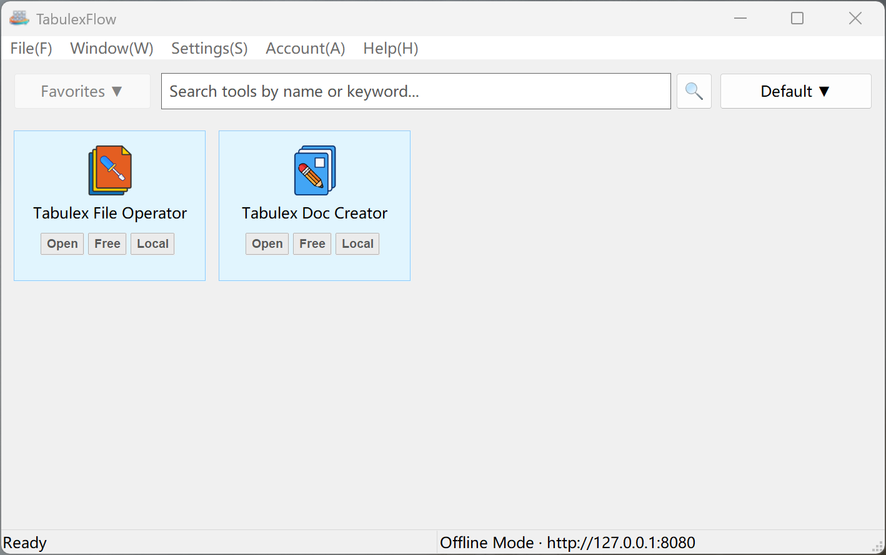
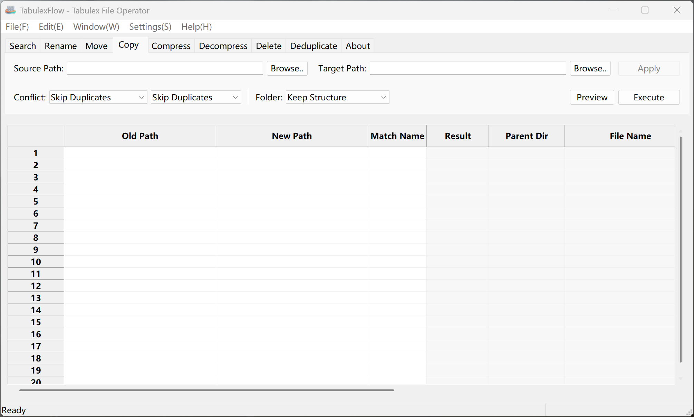
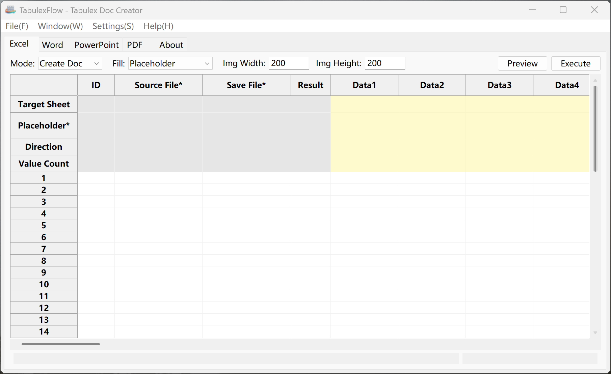

# TabulexFlow Frontend (TabulexFlowDesktop)

[](https://www.gnu.org/licenses/agpl-3.0)
[](https://www.python.org/)
[]()

Desktop frontend application for TabulexFlow, built with Python + wxPython.

> **Tagline**: "TabulexFlow: Table-driven batch task flow that automates repetitive work."

> **Version**: v1.0.0 (2026-10-12)

**What it is**: A lightweight desktop launcher for **table-driven batch task flows** — describe the work once (in a spreadsheet or a few clicks) and it processes files and documents in bulk, instead of repeating the same manual operations again and again.

**Why it's useful**:
- **Batch by design** — bulk search / rename / move / copy / compress / decompress / delete / deduplicate, and bulk generation of Excel / Word / PowerPoint / PDF from a table.
- **Lightweight & cross-platform** — a native wxPython app for Windows and Linux; a single-file binary with no browser or Electron runtime, and the Community Edition runs fully offline with no account.
- **Safe & predictable** — preview before execution in the built-in tools, plus operation-level undo/redo in the File Operator.
- **Extensible & open** — a plugin-style tool system with built-in AGPL v3 tools and a growing tool ecosystem (including Commercial Edition tools).
- **Multi-language** — English, Chinese, French, Russian, Spanish, Arabic.

> **中文版请翻到后面阅读 / Chinese version below** ↓

---

> **Community Edition (open source)**
> This repository contains the desktop **frontend main program + BuiltinProgram (AGPL v3) tools**. The **Community
> Edition** binary — which connects to **no** backend, so login/account, RemoteProgram and RemoteWebpage (Commercial
> Edition features) are unavailable — is produced by `scripts/tfpdesktop_build.sh` / `scripts/tfpdesktop_build.bat` by selecting
> **[1] OSS Community Edition** (the default). The bare `config/build.spec` build described in §3.4 produces the
> backend-connected full edition, not the Community Edition.
>
> **Roadmap**: the set of built-in open-source tools will keep growing, and more official and third-party tools
> (including Commercial Edition tools) are under active development.
>
> **Website availability note**: the official website `https://tabulexflow.com` (including `/download` and `/feedback`
> links) is **not live yet**. Until the site launches, those links will not resolve — the placeholder links inside the
> app and docs are intentional; the Community Edition works fully offline. Please serve bug reports/questions via
> GitHub Issues for now.

---

## Screenshots

> The Community Edition runs fully offline. Below are the main window and the two AGPL v3 built-in tools bundled with it.

**Main window — tool launcher (Favorites, search and tool categories)**



**Built-in tool: Tabulex File Operator — batch search / rename / move / copy / compress / decompress / delete / deduplicate**



**Built-in tool: Tabulex Doc Creator — batch create Excel / Word / PowerPoint / PDF from a table**



---

## Download & Run

> Linux (Debian family: Debian / Ubuntu / Linux Mint; Red Hat family: RHEL / CentOS / Fedora / Rocky / Alma) distributions are provided as **offline, self-contained packages** with no Python installation required. Three formats are available:

**Option A — .deb Package, Debian family (Recommended, install like normal software)**
- Download `tabulexflow_<version>_amd64.deb`
- Method 1: Double-click and select "Install"; Method 2: Terminal
  ```bash
  sudo apt install ./tabulexflow_<version>_amd64.deb
  ```
- After installation, find **TabulexFlow** in the application menu
- Uninstall: `sudo apt remove tabulexflow`

**Option B — .rpm Package, Red Hat family (install like normal software)**
- Download `tabulexflow.x86_64.rpm`
- Terminal:
  ```bash
  sudo dnf install ./tabulexflow.x86_64.rpm
  ```
- After installation, find **TabulexFlow** in the application menu
- Uninstall: `sudo dnf remove tabulexflow`

**Option C — .AppImage (Portable, no installation required)**
- Download `TabulexFlow-<version>-OSS-x86_64.AppImage`
- Make executable and double-click to run; or terminal:
  ```bash
  chmod +x ./TabulexFlow*.AppImage
  ./TabulexFlow*.AppImage
  ```
- If double-click doesn't work, right-click the file → Properties → Check "Allow executing file as program", then double-click

**Windows — Portable Single-File EXE**
- Download `TabulexFlow-<version>-OSS-windows-x64.exe` directly from GitHub Releases (no installation, double-click to run, no extraction needed)
- If SmartScreen "Windows protected your PC" appears on first run: Click "More info" → "Run anyway"
  (EXE is not code-signed; please download only from the official GitHub Releases page)

**Developers / Self-Built Scenarios**
- After building with `scripts/tfpdesktop_build.sh`, output is in `TabulexFlowDesktop/dist/TabulexFlow-<version>-<OSS|Full>[-devtest]` (executable directly)
- Use `scripts/tfpdesktop_dist.sh` to launch the built artifact (it auto-detects the versioned/editioned name); or run it directly, e.g.:
  ```bash
  cd TabulexFlowDesktop/dist && ./TabulexFlow-<version>-<OSS|Full>[-devtest]
  ```
- Generate the distro package (`.deb` on Debian family / `.rpm` on Red Hat family) and `.AppImage`: After building, follow prompts or manually run `scripts/tfpdesktop_package_linux.sh` (it auto-detects the distro family; unsupported distros abort)
- The Windows build writes a checksum manifest at `dist/SHA256SUMS.txt` (SHA-256, `sha256sum -c`-compatible); on Linux the same file (plus optional `SHA256SUMS.gpg`) is written by `scripts/tfpdesktop_package_linux.sh`. The manifest is merged per platform (only the current platform's old entries are replaced; the other platform's entries are kept), and builds no longer wipe the whole `dist/` directory
- Linux build scripts default to the local venv path; use environment variable `TFP_VENV` to specify your own
  Python 3.12 environment: `export TFP_VENV=/path/to/your/py312-venv`
  (On Linux, wx is provided by the system package manager — apt on Debian family, dnf on Red Hat family; see `requirements_linux.txt`)

> **Note**: AppImage is read-only mounted; writable data (tool directory/config) is automatically stored in your user directory
> `~/.local/share/TabulexFlow/`, not in the AppImage itself, so it can be safely placed anywhere.

### Verify Downloads

The release directory `dist` contains `SHA256SUMS.txt` with SHA-256 hashes for all artifacts; if the `SHA256SUMS.gpg`
detached signature is included, you can further verify the publisher's identity.

```bash
# 1. Verify hash (run in the download directory)
sha256sum -c SHA256SUMS.txt

# 2. (Optional) Import project public key and verify GPG signature (requires gpg installed)
gpg --import tabulexflow-release.pubkey.asc   # Public key download link see Release page notes
gpg --verify SHA256SUMS.gpg SHA256SUMS.txt
```

Verification failure (`FAILED`) indicates the file was corrupted or tampered with during download; do not run it, re-download or report to the project.
Verification only confirms file integrity and source authenticity, not a security audit conclusion.

### License & Third-Party Components

- Full license text: [LICENSE.txt](LICENSE.txt) (GNU AGPL v3 or later)
- Third-party dependencies and bundled C runtime libraries with licenses: [docs/NOTICE.txt](docs/NOTICE.txt)

---

## 1. Project Overview

### 1.1 Positioning

- **Product essence**: A table-driven batch-task automation platform using spreadsheets (Excel/CSV) as its unified input and output interface. The frontend and built-in tools are open source under AGPL v3 (Community Edition); the backend and commercial tools are under a commercial license (Commercial Edition)
- **Operation mode**: Manually fill in data in spreadsheets → Click the corresponding tool button → Results are automatically written back to the spreadsheet
- **Platform**: PC (Windows / Linux), no mobile native support

### 1.2 Tool Types

| Tool Type | Description | Open Source | Login Required | Offline |
|-----------|-------------|-------------|----------------|---------|
| **BuiltinProgram** | Built-in tools, bundled with the frontend | AGPL v3 | Yes if the backend is reachable; not required when the backend is unreachable | Available when the backend is unreachable (no offline grace period) |
| **RemoteProgram** | Remote tools provided by the TabulexFlow platform | Closed-source commercial | Yes | Requires the backend |
| **RemoteWebpage** | Web-based tools provided by the TabulexFlow platform | Closed-source commercial | Yes | Not supported |

### 1.3 Core Features

- **Desktop GUI**: Based on wxPython, lightweight with native experience
- **Process isolation**: Non-built-in tools run as independent processes, ensuring AGPL compliance
- **Multi-language**: English, Chinese, French, Russian, Spanish, Arabic
- **Modular architecture**: Extensible tool system
- **Tool ecosystem**: Built-in tools plus a commercial ecosystem of remote and web tools (Commercial Edition)
- **Account & permissions**: User login, tool-level authorization, and enterprise management (Commercial Edition)
- **Continuous updates**: Tool-list and remote-tool updates delivered via the backend (Commercial Edition)

### 1.4 Community Edition vs Commercial Edition

| Capability | Community Edition (open source) | Commercial Edition |
|------------|-------------------------------|--------------------|
| Frontend main program | Yes | Yes |
| Built-in tools (BuiltinProgram, AGPL v3) | Yes | Yes |
| Account, login and tool subscription | No | Yes |
| Remote tools (RemoteProgram) | No | Yes |
| Web tools (RemoteWebpage) | No | Yes |
| Runtime permission control | No | Yes |
| Enterprise management and support | No | Yes |

> **Commercial Edition**: coming soon. For product information and early-access applications, contact `tabulexflow@outlook.com`.

---

## 2. Open Source License

### 2.1 Frontend (TabulexFlowDesktop)

This repository is licensed under **GNU Affero General Public License v3.0 (AGPL v3)**.

```
Copyright (C) 2024-present TabulexFlow Team

This program is free software: you can redistribute it and/or modify
it under the terms of the GNU Affero General Public License as published by
the Free Software Foundation, either version 3 of the License, or
(at your option) any later version.
```

### 2.2 License Requirements

Under AGPL v3, you may:

- Freely use, study, distribute, and improve

But you must comply with the following obligations:

- Retain copyright and license notices, and indicate the modification dates of your changes
- License your modified versions under AGPL v3 and provide the complete corresponding source code to anyone who receives them
- **Network use (AGPL v3 Section 13)**: if you modify this program and let users interact with it over a network (e.g. you host a modified version as a remote service), you must also offer those users the source code of your modified version — this applies even if you never distribute the binaries

### 2.3 Open Source Components

| Component | License |
|-----------|---------|
| Frontend main code (main.py, tfp_utils/, tfp_auth/, tfp_mixins/) | AGPL v3 |
| BuiltinProgram tools (tools_fe/tools_builtin_program/) | AGPL v3 |
| Toolkit SDK (tfp_toolkit/) | AGPL-3.0-or-later OR TabulexFlow Commercial License (dual-licensed) |
| Configuration files (config/) | AGPL v3 |
| Language files (locales/) | AGPL v3 |

### 2.4 Backend

The backend and commercial tools (RemoteProgram, RemoteWebpage) use **commercial licensing** and are not publicly available.

---

## 3. Quick Start

### 3.1 Requirements

- Python 3.12.3
- pip package manager
- Windows or Linux operating system

### 3.2 Install Dependencies

```bash
pip install -r requirements.txt
```

### 3.3 Run

```bash
python main.py
```

### 3.4 Build Executable

This repository can build two editions; the edition is selected interactively by the build scripts:

- **[1] OSS Community Edition (default)** — no backend: frontend main program + BuiltinProgram tools only. This is the edition that matches the open-source release.
- **[2] Full edition** — connects to the backend and adds login/account, RemoteProgram and RemoteWebpage (Commercial Edition features).

```bash
# Linux
bash scripts/tfpdesktop_build.sh

# Windows
scripts\tfpdesktop_build.bat
```

The build script writes the artifact to `dist/` as `TabulexFlow-<version>-<OSS|Full>[-devtest]`
(with a `.exe` suffix on Windows), e.g. `TabulexFlow-1.0.0-OSS.exe`.

> A bare `python -m PyInstaller config/build.spec` builds the **full, backend-connected edition**, because
> `build_mode.IS_OSS_COMMUNITY_BUILD` defaults to `False`; only the build scripts set it to `True` for the
> Community Edition. Do not use the bare command if you intend to build the Community Edition.

For interactive builds and Linux packaging (`.deb` / `.rpm` / `.AppImage`), use the
`scripts/tfpdesktop_build.sh` / `scripts/tfpdesktop_package_linux.sh` scripts. They locate
your Python 3.12 venv via the `TFP_VENV` environment variable:
`export TFP_VENV=/path/to/your/py312-venv` (on Linux, `wxPython` is provided by
the system package manager — apt on Debian family, dnf on Red Hat family — see `requirements_linux.txt`).

### 3.5 ⚠️ Never Commit `dist/` to Git

Build artifacts (`dist/`, `build/`, `*.AppImage`, `*.deb`, `*.rpm`, `*.exe`, `*.zip`) are git-ignored and **must never** be force-added (`git add -f`) or committed — especially to a public repository:

- They may contain **residual credential files** generated at runtime next to the executable. Build scripts (`scripts/tfpdesktop_build.sh`, `scripts/tfpdesktop_build.bat`, `scripts/tfpdesktop_package_linux.sh`) auto-delete such files from `dist/` and from the source tree, but a locally-run binary may recreate them afterwards.
- `dist/` may also contain **closed-source commercial tool binaries** (downloaded from the backend), which must not be published.

Check before committing (should print nothing):

```bash
git status --ignored -- dist build | grep -v "^nothing"
git ls-files dist build   # should print nothing
```

If artifacts were accidentally tracked, remove tracking (keep local files):

```bash
git rm -r --cached dist build
```

---

## 4. Project Structure

```
TabulexFlowDesktop/
├── main.py                          # Main entry point
├── build_mode.py                    # Build/production mode switch + backend address (single source)
├── tfp_auth/                        # Authentication & permissions
│   ├── tfp_auth_manager.py          # Auth manager (singleton)
│   ├── tfp_permission_manager.py    # Permission manager (singleton)
│   ├── tfp_button_permission.py     # Button-level permission handling
│   ├── tfp_permission_decorators.py # Permission decorators
│   ├── tfp_login_dialog.py          # Login/register dialog
│   ├── tfp_enterprise_dialog.py     # Enterprise dialog
│   └── tfp_constants.py             # Auth constants
├── tfp_mixins/                      # Mixin modules (main window feature split)
│   ├── tfp_tool_ipc_mixin.py        # IPC communication mixin
│   └── tfp_tool_runner_mixin.py     # Tool runner mixin
├── tfp_utils/                       # Core utility modules
│   ├── tfp_base_tool.py             # Tool base class + data class definitions
│   ├── tfp_secure_storage.py        # Secure storage
│   ├── tfp_backend_config.py        # Backend URL config manager
│   ├── tfp_api_paths.py             # Backend API path definitions (single source)
│   ├── tfp_platform.py              # Cross-platform build/distribution naming authority
│   ├── tfp_tool_signer.py           # Tool package Ed25519 signature verification
│   ├── tfp_version.py               # Semantic version comparison helpers
│   ├── tfp_webview_fallback.py      # WebView engine selection (RemoteWebpage)
│   ├── tfp_webview_helper.py        # Standalone WebView helper process (Linux fallback)
│   ├── tfp_i18n_manager.py          # Internationalization manager
│   ├── tfp_main_menu.py             # Main menu generation
│   ├── tfp_main_utils.py            # Main program utilities
│   ├── tfp_menu_handler.py          # Menu execution handler
│   ├── tfp_menu_loader.py           # Menu config loader
│   └── tfp_logger.py                # Logger
├── tfp_toolkit/                     # Shared toolkit SDK (dual-licensed, see tfp_toolkit/LICENSE)
├── tools_fe/                        # Tool source directory
│   └── tools_builtin_program/       # Built-in tools
│       ├── TabulexFileOperator/          # Bulk file operations
│       └── TabulexDocCreator/          # Bulk document creation
├── config/                          # Configuration files
│   ├── tool_list_builtin.json       # Built-in tool registry
│   ├── menu_config.json             # Menu configuration
│   ├── language_settings.json       # Language settings
│   ├── build.spec                   # PyInstaller build spec
│   ├── app.manifest                 # Application manifest
│   ├── default_icon.ico             # Default icon
│   └── version.txt                  # Version info (Windows VSVersionInfo + ProductVersion single source)
├── locales/                         # Internationalization files
│   └── en.json / zh.json / fr.json / ru.json / es.json / ar.json
├── docs/                            # Documentation
│   ├── TOOL_BUILTIN_GUIDE.md        # BuiltinProgram development guide
│   ├── USER_MANUAL.md               # User manual
│   ├── manual/                      # Per-tool user manuals
│   │   ├── TabulexFileOperator.md        # TabulexFileOperator user manual (EN + 中文)
│   │   └── TabulexDocCreator.md        # TabulexDocCreator user manual (EN + 中文)
│   ├── images/                      # Screenshots used in this README
│   ├── CONTRIBUTING.md              # Contributing guide
│   ├── CLA.md                       # Contributor license agreement
│   ├── CHANGELOG.md                 # Changelog
│   └── NOTICE.txt                   # Third-party library notices
├── scripts/                         # Build / run / dist-launch / Linux packaging helper scripts (.bat / .sh)
├── tests/                           # Unit tests (pytest)
├── LICENSE.txt                      # AGPL v3 license
├── requirements.txt                 # Python dependencies (Windows)
└── requirements_linux.txt           # Linux-only dependencies (RemoteWebpage fallback engine)
```
> On **Linux**, also install the RemoteWebpage fallback engine: `pip install -r requirements_linux.txt` plus system packages `python3-gi gir1.2-webkit2-4.1 libwebkit2gtk-4.1-0`.

---

## 5. Development Guide

### 5.1 Code Standards

- Follow PEP 8 coding conventions
- Use type annotations
- Public classes use the `TFP_` prefix; module-level helper functions use `snake_case`

### 5.2 Contributing

Please read [docs/CONTRIBUTING.md](docs/CONTRIBUTING.md) for how to contribute.

Before submitting a Pull Request, ensure:

1. You have signed the [docs/CLA.md](docs/CLA.md) Contributor License Agreement
2. Your code follows the project's coding standards

### 5.3 Developing BuiltinProgram Tools

Please read [docs/TOOL_BUILTIN_GUIDE.md](docs/TOOL_BUILTIN_GUIDE.md) for how to develop BuiltinProgram open-source tools.

### 5.4 Developing RemoteProgram Tools

RemoteProgram/RemoteWebpage commercial tool development guide is available in the private backend repository.

---

## 6. Security

### 6.1 Process Isolation

To ensure AGPL compliance, all non-built-in tools run as independent processes, separate from the AGPL v3 main program.

### 6.2 Authorization

User login status is managed by the framework. Use `is_user_logged_in()` and `has_permission()` methods to check authorization status.

---

## 7. Documentation

- [BuiltinProgram Development Guide](docs/TOOL_BUILTIN_GUIDE.md)
- [User Manual](docs/USER_MANUAL.md)
- [TabulexFileOperator User Manual](docs/manual/TabulexFileOperator.md)
- [TabulexDocCreator User Manual](docs/manual/TabulexDocCreator.md)
- [Contributing Guide](docs/CONTRIBUTING.md)
- [Contributor License Agreement](docs/CLA.md)
- [Changelog](docs/CHANGELOG.md)
- [Third-Party Notices](docs/NOTICE.txt)

---

## 8. License Summary

| Project | License | Source Available | Commercial Use | Must Open-Source Modifications |
|---------|---------|-----------------|----------------|-------------------------------|
| TabulexFlowDesktop | AGPL v3 | Yes | Yes | Yes* |
| BuiltinProgram | AGPL v3 | Yes | Yes | Yes* |
| RemoteProgram | Commercial | No | Requires authorization | N/A |
| RemoteWebpage | Commercial | No | Requires authorization | N/A |

> \* **"Must Open-Source Modifications = Yes"**: besides distributing modified versions, if you run a modified version and let users interact with it over a network, you must also offer those users the source code of your modified version (AGPL v3, Section 13). See Section 2.2 above for details.

---

*This project is licensed under the GNU Affero General Public License v3.0.*

---

---

## 中文版

---

> **Tagline**: "灵表：表格驱动批量任务流，让重复工作自动化。"

**作用**：灵表是一款轻量级桌面工具，用**表格驱动的批量任务流**把重复性工作自动化——只需在表格里或界面上把规则描述一次，即可对成批文件与文档执行批量处理，无需反复手工操作。

**优点**：
- **面向批量**：批量搜索 / 重命名 / 移动 / 复制 / 压缩 / 解压 / 删除 / 去重，以及按表格批量生成 Excel / Word / PowerPoint / PDF。
- **轻量跨平台**：基于 wxPython 的原生桌面程序，支持 Windows 与 Linux；单文件体积小、无需浏览器/Electron 运行时；开源社区版完全离线、免账号即可使用。
- **安全可控**：内置工具执行前可预览，文件处理工具支持操作级撤销/重做与操作历史记录。
- **易扩展、开放**：插件式工具系统，内置 AGPL v3 工具，并持续增加更多工具（含商业版）。
- **多语言**：中文、英文、法语、俄语、西班牙语、阿拉伯语。

> **开源社区版**
> 本仓库包含桌面**前端主程序 + BuiltinProgram（AGPL v3）开源工具**。**开源社区OSS版**二进制——不连接任何后端，
> 因此不提供登录/账号、RemoteProgram、RemoteWebpage（商业版功能）——须由 `scripts/tfpdesktop_build.sh` /
> `scripts/tfpdesktop_build.bat` 选择 **[1] OSS 社区版**（默认项）构建产出；§3.4 所述的裸 `config/build.spec`
> 构建产出的是连接后端的完整版，而非社区版。

> **路线图**：内置开源工具将持续增加，更多官方与第三方工具（含商业版工具）正在开发中。

> **官网可用性说明**：官方网站 `https://tabulexflow.com`（含 `/download`、`/feedback` 页面）**尚未上线**。
> 在官网上线前，程序界面与文档中的官网/下载/反馈链接暂时无法访问——这些占位链接为有意保留，开源社区版完全可离线使用。
> 当前请通过 GitHub Issues 反馈问题。

---

## 程序截图

> 开源社区版完全离线运行。下图为程序主窗口，以及随包附带的两款 AGPL v3 内置工具。

**程序主窗口 —— 工具启动器（收藏夹、搜索与工具分类）**


**内置工具：灵表文件处理 —— 批量搜索 / 重命名 / 移动 / 复制 / 压缩 / 解压 / 删除 / 去重**


**内置工具：灵表文档创建 —— 按表格批量生成 Excel / Word / PowerPoint / PDF**


---

## 下载与运行

> Linux（Debian 系：Debian / Ubuntu / Linux Mint；Red Hat 系：RHEL / CentOS / Fedora / Rocky / Alma）发行包，均为**离线、自带运行环境**，无需安装 Python。默认封装为以下三种格式：

**选项 A — .deb 安装包（Debian 系，推荐，像普通软件一样安装进系统）**
- 下载 `tabulexflow_<版本>_amd64.deb`
- 方式 1：双击后选择"安装"；方式 2：终端执行
  ```bash
  sudo apt install ./tabulexflow_<版本>_amd64.deb
  ```
- 安装后从开始菜单找到 **TabulexFlow** 打开
- 卸载：`sudo apt remove tabulexflow`

**选项 B — .rpm 安装包（Red Hat 系，像普通软件一样安装进系统）**
- 下载 `tabulexflow.x86_64.rpm`
- 终端执行
  ```bash
  sudo dnf install ./tabulexflow.x86_64.rpm
  ```
- 安装后从开始菜单找到 **TabulexFlow** 打开
- 卸载：`sudo dnf remove tabulexflow`

**选项 C — .AppImage 免安装（无需安装，拿来即用、可放U盘便携）**
- 下载 `TabulexFlow-<版本>-OSS-x86_64.AppImage`
- 赋予可执行权限后双击运行；或终端执行
  ```bash
  chmod +x ./TabulexFlow*.AppImage
  ./TabulexFlow*.AppImage
  ```
- 不能双击时，先在文件管理器右键 → 属性 → 勾选"允许作为程序执行/可执行"，再双击

**Windows — 免安装单文件 EXE**
- 从 GitHub Releases 直接下载 `TabulexFlow-<版本>-OSS-windows-x64.exe`（免安装，下载后双击运行，无需解压）
- 首次运行如遇 SmartScreen"Windows 已保护你的电脑"提示：点击"更多信息"→"仍要运行"
  （EXE 暂未做代码签名；请仅从官方 GitHub Releases 页面下载）

**开发者 / 已自行编译场景**
- 用 `scripts/tfpdesktop_build.sh` 编译后，产物在 `TabulexFlowDesktop/dist/TabulexFlow-<版本>-<OSS|Full>[-devtest]`（可直接执行）
- 用 `scripts/tfpdesktop_dist.sh` 一键启动编译产物（自动侦测带版本+形态的名称）；或终端直接运行，例如
  ```bash
  cd TabulexFlowDesktop/dist && ./TabulexFlow-<版本>-<OSS|Full>[-devtest]
  ```
- 生成发行包（Debian 系 `.deb` / Red Hat 系 `.rpm`）与 `.AppImage`：编译完成后按提示，或手动执行 `scripts/tfpdesktop_package_linux.sh`（脚本自动侦测发行版家族，不支持的发行版会终止）
- Windows 构建会在 `dist/SHA256SUMS.txt` 写入校验清单（SHA-256，兼容 `sha256sum -c`）；Linux 侧同一文件（及可选的 `SHA256SUMS.gpg`）由 `scripts/tfpdesktop_package_linux.sh` 生成。清单按平台合并写入：仅替换当前平台的旧记录，保留另一平台记录；构建脚本不再整体删除 `dist/`
- Linux 构建脚本默认使用开发主机本地 venv 路径，可用环境变量 `TFP_VENV` 指定自己的
  Python 3.12 环境：`export TFP_VENV=/path/to/your/py312-venv`
  （Linux 上 wx 由系统包管理器提供——Debian 系为 apt、Red Hat 系为 dnf，见 `requirements_linux.txt`）

> **说明**：AppImage 内部是只读挂载，程序的可写数据（工具目录/配置）会自动存到你的用户目录
> `~/.local/share/TabulexFlow/`，不会写入 AppImage 自身，故可安全放在任意位置运行。

### 校验下载文件

发布目录`dist`中的 `SHA256SUMS.txt` 记录了所有产物的 SHA-256 哈希；若附有 `SHA256SUMS.gpg`
分离签名，可进一步验证发布者身份。

```bash
# 1. 校验哈希（在下载目录内执行）
sha256sum -c SHA256SUMS.txt

# 2.（可选）导入项目公钥后验证 GPG 签名（需已安装 gpg）
gpg --import tabulexflow-release.pubkey.asc   # 公钥下载地址见 Release 页面说明
gpg --verify SHA256SUMS.gpg SHA256SUMS.txt
```

校验失败（`FAILED`）说明文件在下载过程中损坏或被篡改，请勿运行，请重新下载或向项目反馈。
校验通过仅代表文件完整性与来源可信，不代表安全性审计结论。

### 许可证与第三方组件

- 本项目许可证全文：[LICENSE.txt](LICENSE.txt)（GNU AGPL v3 or later）
- 第三方依赖与捆绑的 C 运行库及其许可证：[docs/NOTICE.txt](docs/NOTICE.txt)

---

## 1. 项目概述

### 1.1 定位

- **产品本质**: 以表格（Excel/CSV）为统一输入与输出界面的批量任务自动化平台。前端与内置工具以 AGPL v3 开源（开源社区版）；后端与收费工具为商业许可（商业版）
- **操作模式**: 手动在表格中填写数据 → 点击对应工具按钮执行 → 结果自动写回表格
- **运行平台**: PC 端（Windows / Linux），不考虑手机端原生方式运行

### 1.2 工具类型

| 工具类型 | 说明 | 开源状态 | 登录要求 | 离线使用 |
|---------|------|---------|---------|---------|
| **BuiltinProgram** | 内置工具，随前端程序打包 | AGPL v3 开源 | 后端可达时需登录；后端不可达时免登录放行 | 后端不可达时可用（无离线宽限期限制） |
| **RemoteProgram** | 由 TabulexFlow 平台提供的远程工具 | 闭源商业 | 必须登录 | 需连接后端 |
| **RemoteWebpage** | 由 TabulexFlow 平台提供的网页工具 | 闭源商业 | 必须登录 | 不支持离线 |

### 1.3 核心特性

- **桌面 GUI**: 基于 wxPython，轻量且原生体验
- **进程隔离**: 非 builtin 工具以独立进程运行，确保 AGPL 合规
- **多语言支持**: 中文、英文、法语、俄语、西班牙语、阿拉伯语
- **模块化架构**: 易于扩展的工具系统
- **工具生态**: 内置工具 + 由平台提供的商业远程/网页工具生态（商业版）
- **账号与权限**: 用户登录、工具级授权与企业级管理（商业版）
- **持续更新**: 工具列表与远程工具更新由后端下发（商业版）

### 1.4 开源社区版与商业版对比

| 能力 | 开源社区版 | 商业版 |
|------|-----------|--------|
| 前端主程序 | 支持 | 支持 |
| 内置工具（BuiltinProgram，AGPL v3） | 支持 | 支持 |
| 账号、登录与工具订购 | 不支持 | 支持 |
| 远程工具（RemoteProgram） | 不支持 | 支持 |
| 网页工具（RemoteWebpage） | 不支持 | 支持 |
| 运行时权限控制 | 不支持 | 支持 |
| 企业级管理与支持 | 不支持 | 支持 |

> **商业版**：即将推出。如需产品信息或申请内测，请联系 `tabulexflow@outlook.com`。

---

## 2. 开源协议声明

### 2.1 前端工程 (TabulexFlowDesktop)

本仓库采用 **GNU Affero General Public License v3.0 (AGPL v3)** 协议开源。

```
Copyright (C) 2024-present TabulexFlow Team

This program is free software: you can redistribute it and/or modify
it under the terms of the GNU Affero General Public License as published by
the Free Software Foundation, either version 3 of the License, or
(at your option) any later version.
```

### 2.2 协议要求

根据 AGPL v3 协议，您可以：

- 自由使用、研究、分发、改进

但必须遵守以下义务：

- 保留版权与许可声明，并注明修改日期
- 以相同协议（AGPL v3）开源您的修改版本，并向其接收者提供完整源码
- **网络交互使用（AGPL v3 第 13 条）**：若您修改本程序后通过网络让用户与之交互（例如托管一个修改版作为远程服务），您同样必须向这些用户提供修改版的源码——即使您从未分发过程序本身

### 2.3 包含的开源组件

| 组件 | 协议 |
|-----|------|
| 前端主程序代码 (main.py, tfp_utils/, tfp_auth/, tfp_mixins/) | AGPL v3 |
| BuiltinProgram 工具 (tools_fe/tools_builtin_program/) | AGPL v3 |
| 工具 SDK (tfp_toolkit/) | AGPL-3.0-or-later 或 TabulexFlow 商业许可（双许可） |
| 配置文件 (config/) | AGPL v3 |
| 语言文件 (locales/) | AGPL v3 |

### 2.4 后端工程

后端工程及相关商业工具（RemoteProgram、RemoteWebpage）采用**商业许可**，不对外公开源码。

---

## 3. 快速开始

### 3.1 环境要求

- Python 3.12.3
- pip 包管理器
- Windows 或 Linux 操作系统

### 3.2 安装依赖

```bash
pip install -r requirements.txt
```

### 3.3 运行程序

```bash
python main.py
```

### 3.4 构建可执行文件

本仓库可构建两个版本，由构建脚本交互式选择：

- **[1] OSS 社区版（默认）**——不连接后端：仅前端主程序 + BuiltinProgram 工具，即与开源发布对应的版本。
- **[2] 完整版**——连接后端，另含登录/账号、RemoteProgram 与 RemoteWebpage（商业版功能）。

```bash
# Linux
bash scripts/tfpdesktop_build.sh

# Windows
scripts\tfpdesktop_build.bat
```

构建脚本将产物写入 `dist/`，命名为 `TabulexFlow-<版本>-<OSS|Full>[-devtest]`
（Windows 带 `.exe` 后缀），例如 `TabulexFlow-1.0.0-OSS.exe`。

> 注意：直接执行 `python -m PyInstaller config/build.spec` 构建的是**连接后端的完整版**——因为
> `build_mode.IS_OSS_COMMUNITY_BUILD` 默认为 `False`，只有构建脚本会为社区版临时置为 `True`。
> 若要构建社区版，请使用脚本而非该裸命令。

如需交互式构建或 Linux 打包（`.deb` / `.rpm` / `.AppImage`），请使用
`scripts/tfpdesktop_build.sh` / `scripts/tfpdesktop_package_linux.sh` 脚本。它们通过
`TFP_VENV` 环境变量定位您的 Python 3.12 虚拟环境：
`export TFP_VENV=/path/to/your/py312-venv`（Linux 上 `wxPython` 由系统包管理器提供——
Debian 系为 apt、Red Hat 系为 dnf，见 `requirements_linux.txt`）。

### 3.5 ⚠️ 切勿将 `dist/` 提交到 Git

构建产物（`dist/`、`build/`、`*.AppImage`、`*.deb`、`*.rpm`、`*.exe`、`*.zip`）已被 git 忽略，**绝对不能**被强制添加（`git add -f`）或提交——尤其是公开仓库：

- 它们可能包含**运行时在可执行文件旁边生成的残留凭据文件**。构建脚本（`scripts/tfpdesktop_build.sh`、`scripts/tfpdesktop_build.bat`、`scripts/tfpdesktop_package_linux.sh`）会自动删除 `dist/` 和源码树中的此类文件，但本地运行的二进制可能会重新创建它们。
- `dist/` 还可能包含**闭源商业工具二进制文件**（从后端下载），不得发布。

提交前自查（应无输出）：

```bash
git status --ignored -- dist build | grep -v "^nothing"
git ls-files dist build   # 应无输出
```

若产物已被误跟踪，移除跟踪（保留本地文件）：

```bash
git rm -r --cached dist build
```

---

## 4. 项目结构

```
TabulexFlowDesktop/
├── main.py                          # 主程序入口
├── build_mode.py                    # 构建/生产模式开关 + 后端地址（唯一配置源）
├── tfp_auth/                        # 认证与权限模块
│   ├── tfp_auth_manager.py          # 认证管理器（单例）
│   ├── tfp_permission_manager.py    # 权限管理器（单例）
│   ├── tfp_button_permission.py     # 按钮级别权限错误处理
│   ├── tfp_permission_decorators.py # 权限装饰器
│   ├── tfp_login_dialog.py          # 登录/注册对话框
│   ├── tfp_enterprise_dialog.py     # 企业相关对话框
│   └── tfp_constants.py             # 认证常量定义
├── tfp_mixins/                      # Mixin 模块（主窗口功能拆分）
│   ├── tfp_tool_ipc_mixin.py        # IPC 通信 Mixin
│   └── tfp_tool_runner_mixin.py     # 工具运行 Mixin
├── tfp_utils/                       # 核心工具模块
│   ├── tfp_base_tool.py             # 工具基类接口 + 数据类定义
│   ├── tfp_secure_storage.py        # 安全存储
│   ├── tfp_backend_config.py        # 后端 URL 配置管理器
│   ├── tfp_api_paths.py             # 后端 API 路径集中定义（唯一定义处）
│   ├── tfp_platform.py              # 跨平台构建/分发命名权威来源
│   ├── tfp_tool_signer.py           # 工具发布包 Ed25519 签名验证
│   ├── tfp_version.py               # 语义化版本号比较辅助
│   ├── tfp_webview_fallback.py      # WebView 引擎选择分发层（RemoteWebpage）
│   ├── tfp_webview_helper.py        # 独立 WebView 辅助进程（Linux 回退引擎）
│   ├── tfp_i18n_manager.py          # 国际化管理器
│   ├── tfp_main_menu.py             # 主菜单生成逻辑
│   ├── tfp_main_utils.py            # 主程序工具函数
│   ├── tfp_menu_handler.py          # 菜单执行统一处理
│   ├── tfp_menu_loader.py           # 菜单配置加载
│   └── tfp_logger.py                # 日志模块
├── tfp_toolkit/                     # 共享工具 SDK（双许可，见 tfp_toolkit/LICENSE）
├── tools_fe/                        # 工具源码目录
│   └── tools_builtin_program/       # 内置工具
│       ├── TabulexFileOperator/          # 灵表文件处理
│       └── TabulexDocCreator/          # 灵表文档创建
├── config/                          # 配置文件
│   ├── tool_list_builtin.json       # 内置工具注册表
│   ├── menu_config.json             # 菜单配置
│   ├── language_settings.json       # 语言设置
│   ├── build.spec                   # PyInstaller 打包规格
│   ├── app.manifest                 # 应用清单
│   ├── default_icon.ico             # 默认图标
│   └── version.txt                  # 版本信息（Windows VSVersionInfo + ProductVersion 唯一来源）
├── locales/                         # 主程序国际化文件
│   └── en.json / zh.json / fr.json / ru.json / es.json / ar.json
├── docs/                            # 文档目录
│   ├── TOOL_BUILTIN_GUIDE.md        # 开源工具开发指南
│   ├── USER_MANUAL.md               # 用户使用手册
│   ├── manual/                      # 各子工具用户手册
│   │   ├── TabulexFileOperator.md        # 灵表文件处理使用手册（中英双语）
│   │   └── TabulexDocCreator.md        # 灵表文档创建使用手册（中英双语）
│   ├── images/                      # 本 README 使用的程序截图
│   ├── CONTRIBUTING.md              # 贡献指南
│   ├── CLA.md                       # 贡献者许可协议
│   ├── CHANGELOG.md                 # 更新日志
│   └── NOTICE.txt                   # 第三方库使用声明
├── scripts/                         # 构建 / 运行 / 产物启动 / Linux 打包辅助脚本（.bat / .sh）
├── tests/                           # 单元测试（pytest）
├── LICENSE.txt                      # AGPL v3 许可证
├── requirements.txt                 # Python 依赖（Windows）
└── requirements_linux.txt           # Linux 专用依赖（RemoteWebpage 回退引擎）
```
> **Linux** 上还需安装 RemoteWebpage 回退引擎：`pip install -r requirements_linux.txt`，以及系统包 `python3-gi gir1.2-webkit2-4.1 libwebkit2gtk-4.1-0`。

---

## 5. 开发指南

### 5.1 代码规范

- 遵循 PEP 8 编码规范
- 使用类型注解
- 公开类使用 `TFP_` 前缀命名；模块级辅助函数使用 `snake_case`

### 5.2 提交贡献

请阅读 [docs/CONTRIBUTING.md](docs/CONTRIBUTING.md) 了解如何贡献代码。

在提交 Pull Request 之前，请确保：

1. 已签署 [docs/CLA.md](docs/CLA.md) 贡献者许可协议
2. 代码遵循项目的代码规范

### 5.3 开发开源子工具

请阅读 [docs/TOOL_BUILTIN_GUIDE.md](docs/TOOL_BUILTIN_GUIDE.md) 了解如何开发 BuiltinProgram 类型的开源子工具。

### 5.4 开发收费子工具

RemoteProgram/RemoteWebpage 收费子工具开发指南位于闭源后端仓库中。

---

## 6. 安全机制

### 6.1 进程隔离

为确保 AGPL 协议合规，所有非内置工具均以独立进程运行，与 AGPL v3 主程序相互隔离。

### 6.2 授权验证

用户登录状态由框架管理。请使用 `is_user_logged_in()` 和 `has_permission()` 方法检查授权状态。

---

## 7. 文档

- [开源工具开发指南](docs/TOOL_BUILTIN_GUIDE.md)
- [用户使用手册](docs/USER_MANUAL.md)
- [灵表文件处理使用手册](docs/manual/TabulexFileOperator.md)
- [灵表文档创建使用手册](docs/manual/TabulexDocCreator.md)
- [贡献指南](docs/CONTRIBUTING.md)
- [贡献者许可协议](docs/CLA.md)
- [更新日志](docs/CHANGELOG.md)
- [第三方库声明](docs/NOTICE.txt)

---

## 8. 许可证摘要

| 项目 | 协议 | 源码可见 | 商业使用 | 修改后开源 |
|-----|------|---------|---------|-----------|
| TabulexFlowDesktop | AGPL v3 | 是 | 是 | 必须* |
| BuiltinProgram | AGPL v3 | 是 | 是 | 必须* |
| RemoteProgram | 商业许可 | 否 | 需授权 | N/A |
| RemoteWebpage | 商业许可 | 否 | 需授权 | N/A |

> \* **"修改后开源 = 必须"**：除分发修改版外，若将修改版通过网络服务提供给用户使用，同样必须向这些用户提供修改版源码（AGPL v3 第 13 条）。详见上文 2.2 节。

---

*本项目基于 GNU Affero General Public License v3.0 协议开源。*

